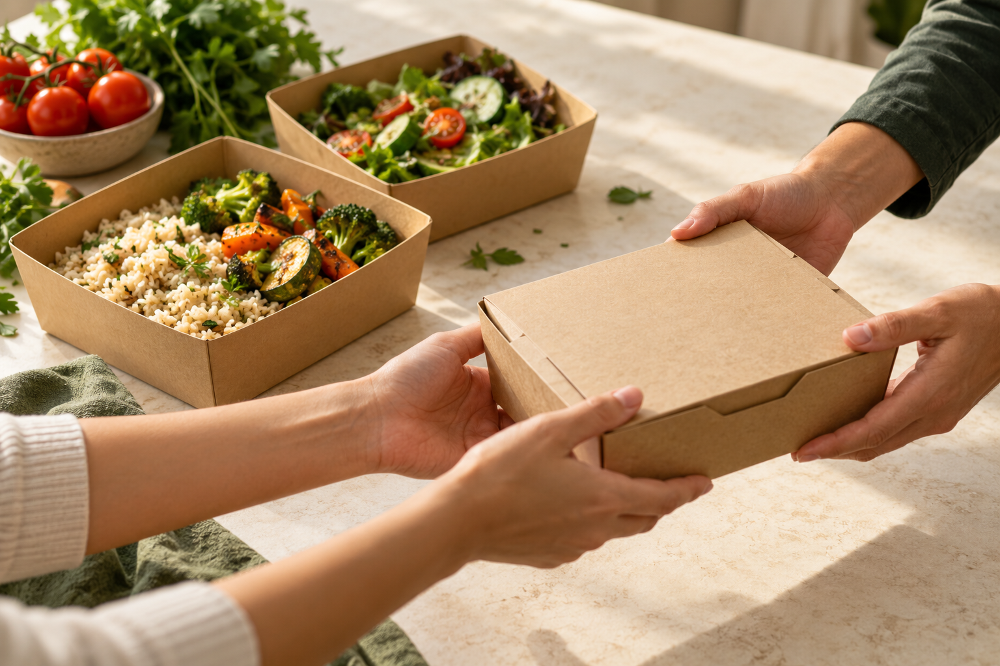

<p align="center">
  
</p>

<h1 align="center">Good food. Better shared.</h1>

<p align="center">
  A food rescue platform for Nasr City, Cairo.<br>
  Match surplus meals with recipient needs, reserve quantities, and follow delivery from pickup to handover.
</p>

<p align="center">
  <a href="#quick-start-windows">Quick start</a> ·
  <a href="#how-to-use-savebite">User guide</a> ·
  <a href="#how-matching-and-routing-work">Algorithms</a> ·
  <a href="#troubleshooting">Troubleshooting</a>
</p>

<p align="center">
  
  <br>
  <sub>Food-sharing illustration used in the application.</sub>
</p>

## What is SaveBite?

SaveBite helps restaurants and food donors redirect surplus meals to charities and care organizations. Instead of choosing a recipient by distance alone, it checks food compatibility and current needs, then ranks eligible recipients by priority. After a reservation is confirmed, the app can calculate a delivery route using A* on an OpenStreetMap road graph.

**This repository contains a locally run Streamlit application.** Downloading the project gives you your own instance with a new local database; it does not connect you to another user's accounts or donations. There is no hosted public demo in this release.

## Features

- **Restaurant and administrator accounts** with different permissions.
- **Donation management** with food category, meal quantity, pickup location, and collection deadline.
- **Recipient needs** recorded and maintained by the administrator.
- **Explainable priority matching** based on urgency, deadline, people served, unmet demand, and proximity.
- **Atomic reservations** that update donation and recipient balances together.
- **A* route planning** on a directed street network, with supported access and turn restrictions.
- **Delivery tracking** for reserved, in-transit, delivered, and cancelled bookings.
- **A Nasr City map** with searchable places and consistent restaurant/recipient marker colors.
- **Arabic and English interfaces**, responsive layouts, and light animations.
- **Activity reset with an automatic backup**, available only to the administrator.

## Quick start (Windows)

### Before you begin

You need:

- **Python** installed; Python **3.12 is the recommended starting version** and was used in development checks.
- The **Python Launcher** (`py` command) for the Windows starter scripts.
- An **internet connection** to install dependencies and load map services and the first street-network download.

You can install Python from [python.org](https://www.python.org/downloads/). Git is optional if you download the ZIP.

### 1. Get the project

On this repository page, select **Code → Download ZIP**, then extract the archive.

Alternatively, if Git is installed:

```bash
git clone https://github.com/Mohamed-233/SaveBite.git
cd SaveBite
```

### 2. Start the app

Open the extracted project folder and double-click:

```text
RUN_SAVEBITE.bat
```

The starter script creates a virtual environment, installs the required packages when needed, and starts the application.

### 3. Create your administrator account

On the first run, enter:

| Prompt | What to enter |
| --- | --- |
| `Admin username` | Your chosen username: 3–50 characters using English letters, digits, `.`, `_`, or `-`. |
| `Display name` | The name you want to display in the app. |
| `Password` | A password containing 12–128 characters. |
| `Repeat password` | The same password again. |

**Password entry is hidden:** no letters, dots, or asterisks appear while you type. This is normal. Type your password and press **Enter**.

When you see `Administrator saved`, sign in using the account you just created. There is no default administrator username or password.

### 4. Open SaveBite

Use the **Local URL** printed in the terminal, such as:

```text
http://localhost:8501
```

The port may be different if another application is already using it. **Use the URL actually shown in your terminal and keep that window open while using the app.**

For future sessions, double-click `RUN_SAVEBITE.bat` again. You only create the administrator account on the first run.

<details>
<summary><strong>Prefer using the terminal?</strong></summary>

From the project folder, run these commands in Windows PowerShell:

```powershell
py -3 -m venv .venv
.\.venv\Scripts\python.exe -m pip install -r requirements.txt
.\.venv\Scripts\python.exe setup_admin.py --ensure
.\.venv\Scripts\python.exe -m streamlit run app.py
```

On macOS or Linux, use the manual setup:

```bash
python3 -m venv .venv
source .venv/bin/activate
python -m pip install -r requirements.txt
python setup_admin.py --ensure
python -m streamlit run app.py
```

The `.bat` files are Windows-only. The manual macOS/Linux instructions use the same Python entry points; platform-specific behavior should be checked on the target device.

</details>

## Who uses the app?

| Role | What they can do |
| --- | --- |
| **Administrator** | Record and update recipient needs, review all donations and reservations, manage restaurant accounts, and reset activity data. |
| **Restaurant / donor** | Create an account, add donations, review recipient suggestions, and manage their own reservations and delivery status. |
| **Charity / care organization** | Does not need an account in this workflow. The administrator records its reported needs. |

Restaurants can access only the donations and reservations belonging to their own account. Selecting a restaurant from the map does not grant access to another account's records.

## How to use SaveBite

### Administrator: prepare recipient needs

1. Sign in using your administrator account.
2. Open **Administration → Recipient needs**.
3. Select a charity or care organization.
4. Enter its actual need, suitable food categories, urgency, number of people, address, and deadline.
5. Review the details and save the record.

### Restaurant: add and reserve a donation

1. On the sign-in screen, select **Create restaurant account** and register.
2. Sign in and open **Add donation**.
3. Select the pickup restaurant and enter the food category, meal quantity, and pickup deadline.
4. Review the address and location, confirm the details, and save.
5. Review the suggested recipient, including any dietary notes. Coordinate pickup with the recipient before confirming the reservation.

A suggestion alone does **not** reserve food. Confirming a reservation updates both the available meals and the recipient's remaining need.

### Track the delivery

Open the registered reservations on the home page:

| Action | When to use it |
| --- | --- |
| **View route** | After reserving a donation, to display the planned street route. |
| **Start delivery** | When the food has been collected and delivery has started. |
| **Confirm delivery** | After confirming that the recipient received all meals in the reservation. |
| **Cancel reservation** | After confirming that the meals remain available or have actually been returned to the restaurant. |

Cancellation restores the reserved quantities once. A delivered reservation cannot be cancelled through this workflow.

> **Trying the project for the first time?** Create one recipient need as the administrator, sign out, then use a restaurant account to add a matching donation. Reserve a small quantity and complete the delivery steps.

## How matching and routing work

### Recipient matching: who should receive the food?

SaveBite first checks whether a need is active, confirmed, unexpired, inside the service area, and compatible with the donation's food category. Eligible recipients are then ranked using a transparent weighted score.

| Factor | Maximum contribution |
| --- | ---: |
| Urgency | 50 points |
| Time remaining before the recipient's deadline | 20 points |
| Number of people served | 15 points |
| Remaining meal demand | 10 points |
| Straight-line proximity | 5 points |

The proposed quantity is the smaller of the donation's available meals and the recipient's unmet need. The **Other** food category requires manual review and does not receive automatic recipient recommendations.

**The matching system is rule-based; it is not a trained machine-learning model.** Dietary notes and food suitability still require human review.

### A*: how should the delivery travel?

After a recipient has been selected and a reservation confirmed, A* searches the represented road network using:

```text
f(n) = g(n) + h(n)
```

- `g(n)`: distance already travelled along road segments.
- `h(n)`: great-circle distance from the current road node to the destination.
- **Objective:** shortest road distance within the filtered graph, rather than live travel time.

The routing model supports road direction and a defined set of access and turn restrictions. It does not calculate traffic, estimated arrival time, or every real-world driving constraint. Dashed endpoint connectors are approximate links to the network and are excluded from the displayed road distance.

See [DOCTOR_NOTES.md](DOCTOR_NOTES.md) for the detailed algorithm explanation and verification scope.

## Technology

| Area | Tools |
| --- | --- |
| Application | Python, Streamlit |
| Local persistence | SQLite |
| Maps | Folium, streamlit-folium, OpenStreetMap |
| Routing | Custom A* implementation with a priority queue |
| Accounts | Salted scrypt password hashes and expiring server-side sessions |
| Interface | Custom CSS, SVG branding, Arabic/English localization |

## Code guide

| File or folder | Purpose |
| --- | --- |
| [`app.py`](app.py) | Application entry point and account-aware navigation. |
| [`auth.py`](auth.py) · [`auth_ui.py`](auth_ui.py) | Authentication, ownership checks, and account screens. |
| [`database.py`](database.py) · [`beneficiary_needs.py`](beneficiary_needs.py) | Donation storage and recipient needs. |
| [`priority.py`](priority.py) | Recipient eligibility and weighted ranking. |
| [`allocations.py`](allocations.py) · [`workflow.py`](workflow.py) | Atomic reservations and delivery transitions. |
| [`astar_routing.py`](astar_routing.py) · [`routing_data.py`](routing_data.py) | A* search and road-network loading. |
| [`pages/`](pages/) · [`savebite_ui.py`](savebite_ui.py) | Map, donation, and administration pages. |
| [`assets/`](assets/) | Brand graphics, illustration, and interface styles. |
| [`tests/test_accounts.py`](tests/test_accounts.py) · [`verify_astar.py`](verify_astar.py) | Account/workflow tests and offline routing verification. |

## Tests

From the project folder, after installing dependencies:

```powershell
.\.venv\Scripts\python.exe tests/test_accounts.py
.\.venv\Scripts\python.exe verify_astar.py
```

On macOS/Linux with the virtual environment activated, replace `.\.venv\Scripts\python.exe` with `python`.

- **Account and workflow tests:** temporary test databases for account isolation, authorization, reservations, delivery, cancellation, reset, migration, and concurrency checks.
- **A* verifier:** 400 synthetic A*/Dijkstra comparisons, plus checks for directed edges, heuristic consistency, one-way travel, and identical start/end nodes. It runs offline using Python's standard library.

These tests verify the implemented model; they do not certify live map completeness or every real-world road rule.

## Local data and backups

The application creates `data/savebite.db` on first setup. User records, road snapshots, and reset backups stay on the computer running that instance.

Keep the following entries in `.gitignore`:

```gitignore
.venv/
data/
__pycache__/
*.pyc
.env
.env.*
.streamlit/secrets.toml
```

Ignoring a file does not remove it from earlier commits.

- Before replacing an existing installation, stop the app and back up the complete project folder. Keep the existing `data/` folder.
- Administrator activity reset requires the current password and typing `RESET`. It backs up the database before deleting donations, needs, reservations, and events.
- Reset preserves accounts, the static place catalogue, and road snapshots. Reset backups are stored in `data/backups/`.
- Legacy donations without an account owner remain visible only to the administrator.

## Troubleshooting

| Problem | What to do |
| --- | --- |
| `py` is not recognized | Install Python with its Windows launcher, then reopen the terminal. |
| Administrator setup rejects the password | Choose 12–128 characters and enter the same password twice. Hidden typing is normal. |
| Administrator sign-in fails | Run `SETUP_ADMIN.bat`, use the **same administrator username**, and set a new password. Wait for `Administrator saved`, then sign in again. |
| A restaurant user forgot their password | Ask the administrator to reset it under **Administration → Accounts**. |
| Too many sign-in attempts | Wait for the 15-minute attempt window to end, or use the appropriate password-reset procedure. |
| The browser does not open automatically | Copy the **Local URL** printed in the terminal into your browser. |
| No recipient is suggested | Check that the administrator saved an active, confirmed, unexpired need with a matching food category and remaining demand. |
| The map or route cannot load | Check the internet connection and retry. Road data are downloaded on first use and cached locally. A routing failure does not change reservation balances. |
| Another person cannot open your `localhost` link | `localhost` refers to their own device. For a same-network test, use the running computer's **Network URL** and allow access through its firewall where needed. Public access requires separate hosting. |

## Data sources and scope

The project focuses on its mapped **Nasr City service area**. Place information includes OpenStreetMap and published directory records. A catalogue listing does not mean that an organization is a registered partner or currently accepting donations; current needs are entered by the administrator.

Map and road availability depend on external services. OpenStreetMap attribution is retained in the application: **© OpenStreetMap contributors**. See [OpenStreetMap attribution](https://www.openstreetmap.org/copyright) and [DESIGN_NOTES.md](DESIGN_NOTES.md) for the project's visual asset notes.

This release uses **local SQLite storage**. Uploading the source to GitHub does not host the application, and adding a cloud database URL does not switch its storage backend.

---

Maintained by **[Mohamed Ahmed Fawzy](https://github.com/Mohamed-233)**.

Questions or feedback? Open an issue with a short description and steps to reproduce the problem. Remove credentials and personal records before sharing logs or screenshots.
